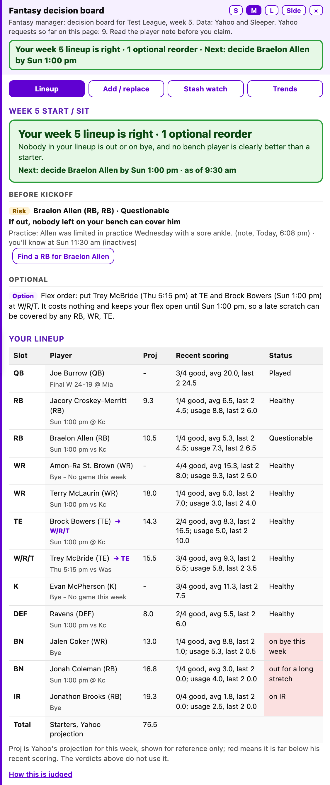
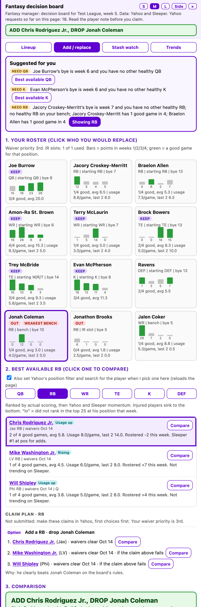
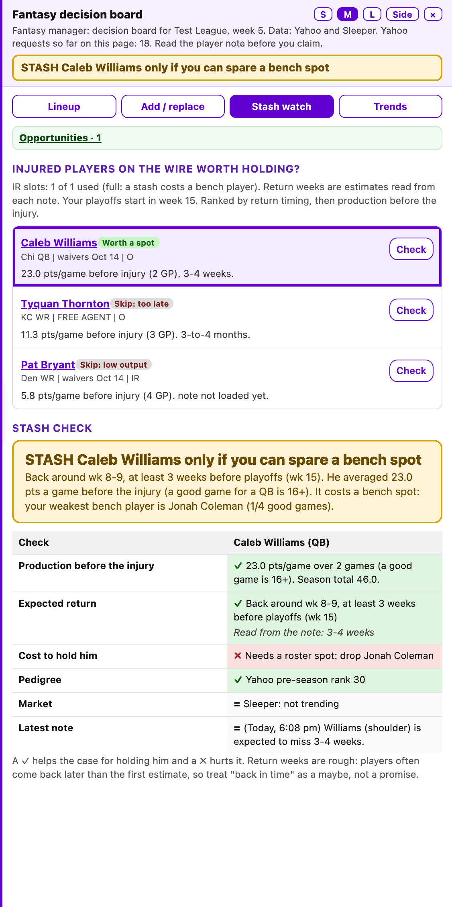

# Yahoo Fantasy Manager

A read-only helper for Yahoo Fantasy Football. It adds a slide-out tray to Yahoo's own pages that tells you who to
start, who to add, who to drop and what to watch before kickoff, for any league you belong to.

It **never adds, drops, trades, submits or changes anything on Yahoo**. It reads pages you can already see with your
own login, and you make every move yourself.

## What it does

- **Lineup tab.** Starters who are out or on bye and who to start instead, clear upgrades from your bench, a plan for
  each questionable starter (his backup, the last moment you can act, when inactives come out), flex-order tips for
  Thursday and early games, and players whose games have started marked as locked.
- **Add / replace tab.** The best free agents at a position, ranked by recent scoring and momentum, a side-by-side
  comparison with the player you would drop, and a claim plan with alternates if a waiver claim fails.
- **Stash watch tab.** Injured free agents worth holding, with a return estimate checked against your playoffs.
- **Trends tab.** Daily snapshots of your league's wire, transactions and Sleeper's most-added players.
- **Alerts.** Role changes in player notes, widely rostered players just dropped in your league, and stash candidates,
  in one "Opportunities" line. If you are in more than one league, the tray header shows the other league's verdict.

### Screenshots

These are drawn from the offline test data, not a real league (`npm run screenshots` regenerates them).

| Lineup tab | Add / replace tab | Stash watch tab |
| --- | --- | --- |
| [](media/lineup.png) | [](media/add-replace.png) | [](media/stash.png) |
| The verdict and next deadline, a plan for a questionable starter, a flex-order tip, and your lineup with locked players and recommended moves tagged. | Your roster, the best free agents at a position, a claim plan with alternates, and a side-by-side verdict. | Injured free agents worth holding, checked against your playoff weeks. |

Players are judged on consistent scoring (the last 4 weeks, weighted to the last 2) and usage, not one-week
projections; kickers and defenses go by Yahoo's projection because they swing with the matchup. The full rules are in
[extension/README.md](extension/README.md).

## What you need

- **Google Chrome** (other Chromium browsers usually work, but only Chrome is tested).
- **Tampermonkey** or **Violentmonkey** from the Chrome Web Store, to run the script.
- A **Yahoo Fantasy Football** team. The tray only appears in leagues you belong to.
- Only to build it yourself: **Git** and **Node.js 22 or newer** (which includes npm).

## Install

### 1. Install Tampermonkey and allow userscripts

Add **Tampermonkey** (or Violentmonkey) to Chrome from the Chrome Web Store. Recent Chrome versions only run
userscripts when you allow it: open `chrome://extensions`, click **Details** on Tampermonkey and turn on
**Allow User Scripts**. On older Chrome versions, turn on **Developer mode** at the top right of
`chrome://extensions` instead.

### 2. Install the script

Open this link in Chrome:

**https://github.com/cozmomk/fantasy-manager/releases/latest/download/fantasy-manager.user.js**

Tampermonkey shows an install page: click **Install**. That's it: installed copies update themselves from the same
link whenever a new release is published. Every release is also listed on the repository's **Releases** page.

### 3. Open your league

Go to `https://football.fantasysports.yahoo.com`, open one of your leagues and click **My Team**. The tray slides in
from the right. The first visit to a league reads its settings (scoring, roster slots, playoff weeks) and takes about
10 to 30 seconds, because requests to Yahoo are deliberately spaced out. Later visits reuse what was saved.

The tray works on your team page, the league home page, the matchup page, any **Players** list, the league
**Settings** page and Yahoo's page for adding a player.

## Updating

Tampermonkey checks the download link for a newer version about once a day. To update right away, open its menu and
click **Check for userscript updates**. Refresh the Yahoo tab after an update.

## Build it yourself instead

To run your own copy of the code (for example, to change it):

```bash
git clone <this repository's URL>
cd <the folder git just created>
npm install
npm run serve
```

`npm run serve` builds the userscript and serves it at `http://localhost:8787/fantasy-manager.user.js`, only on your
own computer. Open that address in Chrome and click **Install** (remove the released copy first, so only one runs).
While the server runs, Tampermonkey picks up your changes when it checks for updates. If you stop the server, turn off
update checks for this script in Tampermonkey (its **Settings** tab for the script) so it does not try to reach
`localhost`.

Prefer not to use a userscript manager? The same code loads as an unpacked Chrome extension: turn on Developer mode
in `chrome://extensions`, click **Load unpacked** and choose the `extension/` folder. Use one or the other, not both.

## Using the tray

- **S, M, L** set the tray's width over the page; **Side** docks it beside the page as a narrow sidebar. Wider sizes
  show more columns (Yahoo's projection, the game time, % started).
- The colored line under the header is the verdict for the tab you are on. On the Lineup tab it also names your next
  deadline.
- Every recommendation shows its reasons. Read the player's note before you claim anyone: the tool reads text, not
  meaning.
- A yellow or red banner at the top means Yahoo changed a page the tool reads. Red means it stopped recommending
  rather than guess; see [If Yahoo changes its pages](extension/README.md#if-yahoo-changes-its-pages).

## Privacy and how it treats Yahoo

- **No server, no account.** Everything runs in your browser. Saved data (league settings, cached pages, daily
  snapshots) stays in your browser's storage for the Yahoo site.
- **Read-only.** It only sends plain page requests (GET) to Yahoo with your existing login, plus Yahoo's own name
  search when you pick a player. It never clicks Yahoo's buttons or submits Yahoo's forms.
- **Polite.** One Yahoo request at a time, spaced out, cached for 30 minutes and shared across tabs. If Yahoo ever
  answers "Request denied", every request stops for 20 minutes. Nothing runs in the background: requests happen only
  while you have a Yahoo page open.
- **Sleeper.** Trends and a second injury opinion come from Sleeper's public API (`api.sleeper.app`), with no login.

## Troubleshooting

- **No tray appears.** Check that Tampermonkey shows the script as enabled, that **Allow User Scripts** (or
  Developer mode) is on, and that you are on a page of a league you belong to. Then refresh the page.
- **"Fantasy manager: could not build the board".** Yahoo may be slow or have paused requests. Wait a few minutes and
  refresh. A pause after "Request denied" lasts 20 minutes.
- **The week or bye weeks look wrong.** Open the league's **Settings** page once to re-read its settings.
- **Two trays, or everything loads twice.** You have both the userscript and the unpacked extension installed. Remove
  one.

## Development

```bash
npm install
npm run check        # lint plus the full offline test suite (about two minutes)
npm run serve        # build and serve the userscript for Tampermonkey
npm run userscript   # just write dist/fantasy-manager.user.js
npm run release      # maintainers: check, then publish the committed code as a new GitHub Release
```

`npm run release` needs the GitHub CLI (`gh`) logged in with write access to the repository. It builds from the last
commit (so commit first), versions the script by that commit's time, and attaches it to a new release marked latest:
the download link above then serves it, and installed copies update to it.

The tests drive your installed Google Chrome through Playwright with every Yahoo and Sleeper page mocked
(`tests/fixtures.js`), so they never touch the real sites and need no browser download. GitHub Actions runs
`npm run check` on every push.

| Path | What it is |
| --- | --- |
| `extension/content.js` | The whole tool: data loading, rules, and the tray UI. |
| `extension/README.md` | Every feature and the rule behind each verdict. |
| `scripts/userscript.js` | Builds and serves the userscript (adds the Tampermonkey header). |
| `scripts/screenshots.js` | Renders the README screenshots in `media/` from the test data. |
| `tests/` | Offline tests; `fixtures.js` is the mock Yahoo built from real page structure. |
| `CLAUDE.md` | Rules for anyone (or any AI assistant) changing the code. Read it first. |
| `TODO.md` | Ideas and planned work. |

Rules every change must follow, in short (full list in [CLAUDE.md](CLAUDE.md)):

- Never add code that adds, drops, trades, submits or changes lineups.
- Every Yahoo request goes through `yfetch` (paced, cached, paused on "Request denied"). No parallel requests,
  background polling or scheduled runs.
- Text from Yahoo pages is shown as text, never run as code.
- Check a real Yahoo page before relying on a new selector, then add a fixture and a test.

## Disclaimer

Not affiliated with or endorsed by Yahoo or Sleeper. It reads pages from your own logged-in session for your own use;
use it in line with Yahoo's terms of service. Its suggestions are opinions built on a few simple rules, not
guarantees.
